<p align="center">
  
</p>

<h1 align="center">Adda Khana</h1>

<p align="center">
  A real-time hangout app you host yourself: one-to-one chat with voice and video calls,<br>
  rooms with group chat and a live voice table, and videos watched together.
</p>

<p align="center">
  <a href="https://github.com/sousvkeet/addabaj/releases/latest"><b>Download the Android app</b></a>
  &nbsp;·&nbsp;
  <a href="#quick-start"><b>Host it yourself</b></a>
</p>

<p align="center">
  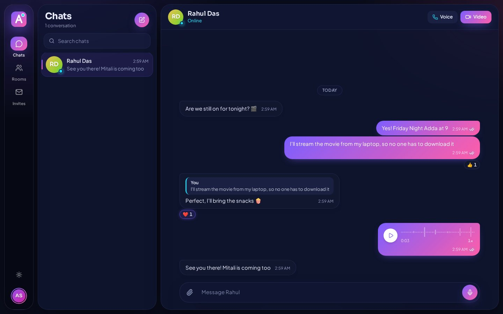
</p>

## Contents

- [Highlights](#highlights)
- [Screenshots](#screenshots)
- [Quick start](#quick-start)
- [Features](#features)
- [Host admin](#host-admin)
- [Configuration](#configuration)
- [Production](#production)
- [Android app](#android-app)
- [Scripts](#scripts)
- [Tests](#tests)
- [Project layout](#project-layout)
- [Security](#security)
- [Limits to know about](#limits-to-know-about)

## Highlights

- **Chat** one to one or in rooms, with photos, videos, files, voice messages, replies and emoji reactions, links with preview cards, editing and forwarding. Mute, pin and archive chats. Nobody is listed: find people by user ID or email, and join rooms with an invite code (open or password protected).
- **Stay safe** on a public server: block someone so they can't message or call you, and report people and messages to the host admin, who sees them in Admin › Reports and can take a message down or switch an account off.
- **Call** with HD voice and video, routed through Cloudflare's TURN relay when networks block direct connections.
- **Hang out** in rooms with a live voice table for up to 12 people, where whoever speaks lights up, and turn cameras on for a group video call. Room admins can mute someone or stop their camera, and clear the chat history now or on a schedule.
- **Watch together:** paste a link from almost any site, and the server finds the video and keeps everyone in sync. You can also stream a file or your screen live from your device.
- **On Android:** a native app that feels like other messengers. It opens straight onto your chats (even offline), screens slide in and out, you press and hold or swipe messages, and messages written offline send themselves later. It also has notifications while it's closed, calls that ring like phone calls (even on the lock screen), calls that keep going in the background, screen sharing, and updates the host publishes (optional or mandatory) that install from inside the app.
- **Run the site** from a host admin panel with live numbers, people, rooms, reports, sign-ups, announcements, email, how messages work, and app updates.
- **Look good** in two themes: "Midnight Aurora" (dark, the default) and "Ocean Mint" (light), with layouts made for phones too.

## Screenshots

| Room with live voice | Host admin |
|---|---|
| 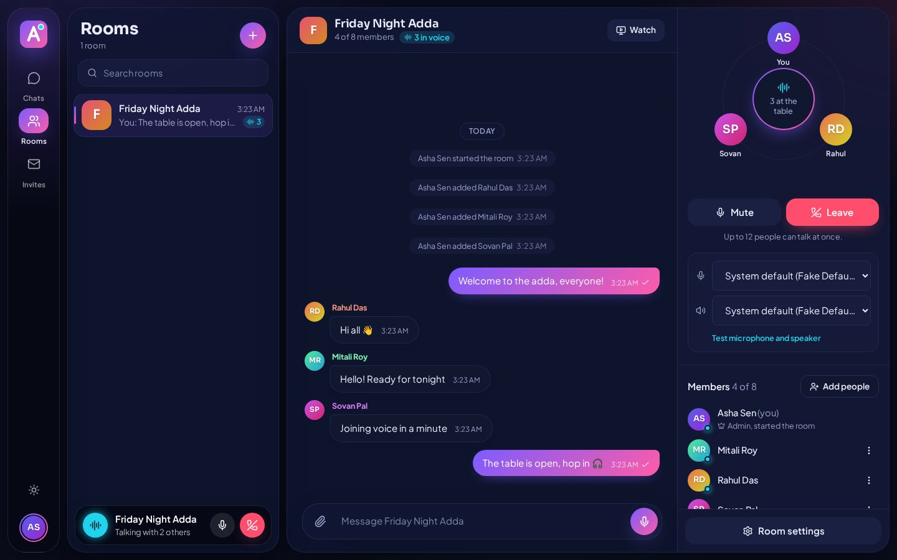 | 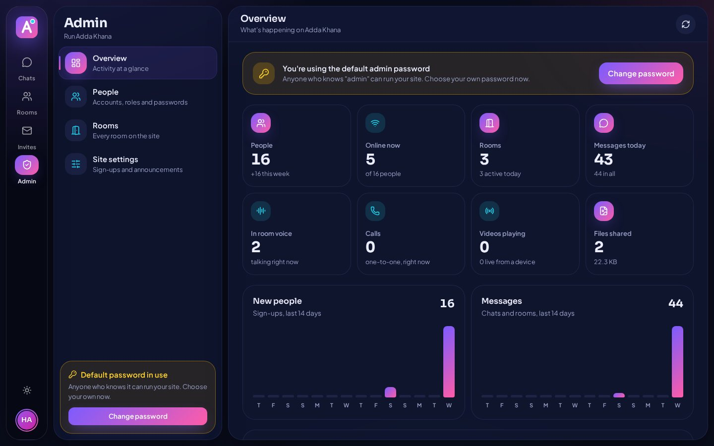 |
| **Light theme (Ocean Mint)** | **Sign in** |
| 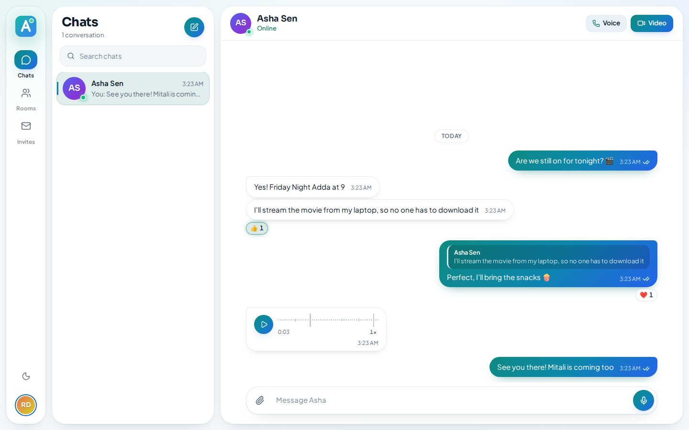 | 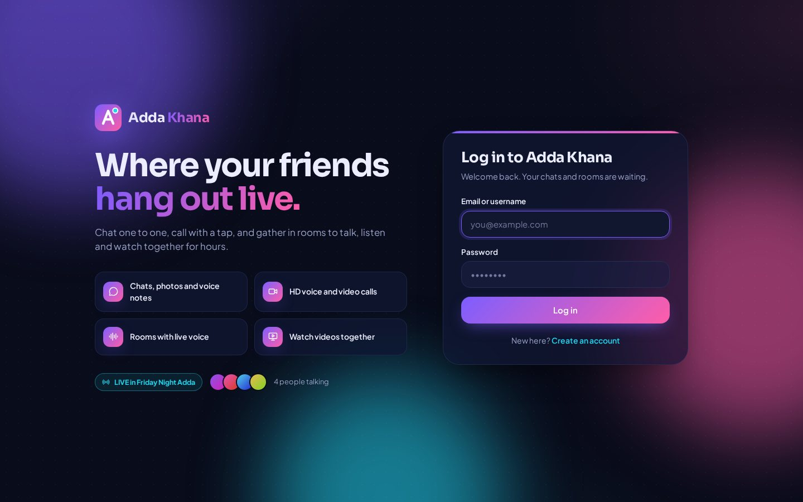 |

<p align="center">
  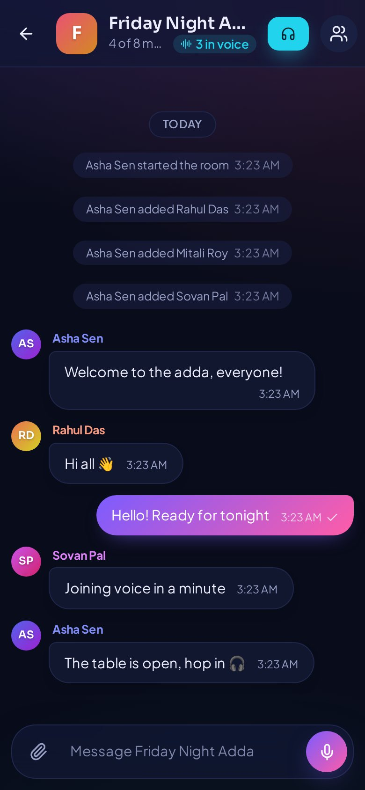
</p>

**Finding people and joining rooms:** nobody is listed. You find people by their user ID or email, and join rooms with an invite code.

| Start a chat by user ID | Join a room with a code |
|---|---|
| 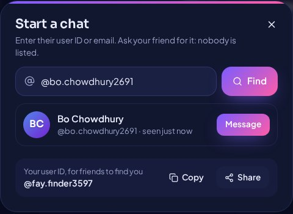 | 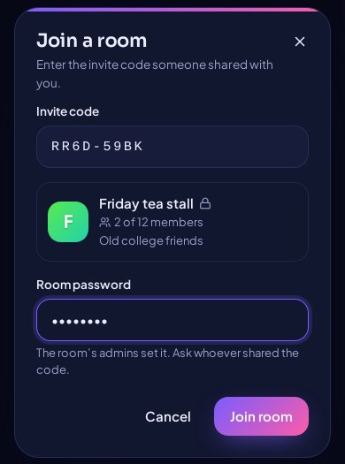 |

**The Android app:**

| Incoming call (over the lock screen) | Reply from a notification | A call in progress |
|---|---|---|
| 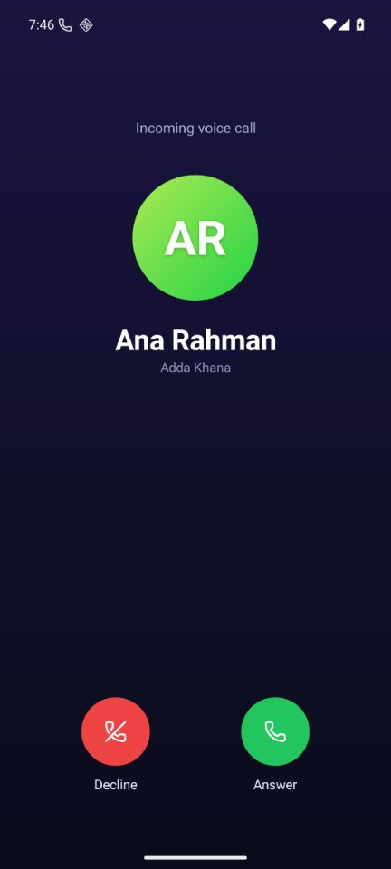 | 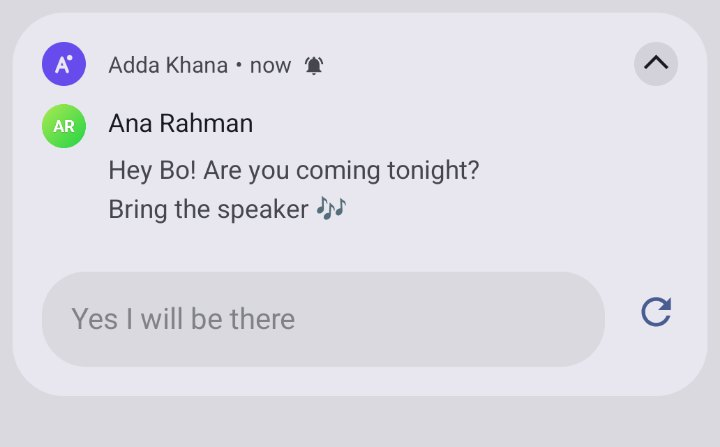 | 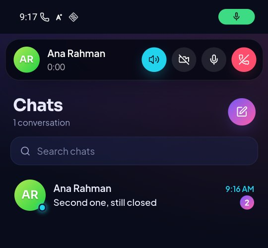 |

A phone sharing its screen live to a room, as a computer sees it:

<p align="center">
  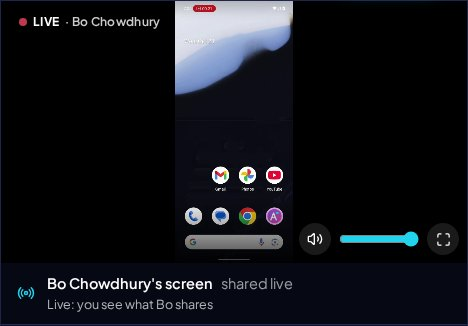
</p>

## Quick start

You need **Node.js 20.19 or newer** (22 recommended) and **PostgreSQL 13 or newer**. The server alone runs on Node 20.12 and up; building the client with Vite 7 needs 20.19.

```sh
git clone git@github.com:sousvkeet/addabaj.git adda-khana
cd adda-khana

cp server/.env.example server/.env    # then set DATABASE_URL and a long random JWT_SECRET
cp client/.env.example client/.env
createdb adda_khana                   # the tables are created on first start

npm install
npm run setup:yt-dlp                  # optional: finds videos on about 1,800 sites
npm run setup:ffmpeg                  # optional: joins sites' separate picture and sound (about 160 MB)
npx playwright install chromium       # optional: the deep scan for JavaScript video players

npm run dev
```

Open **http://localhost:5180** and log in as **`admin` / `admin`** to run the site, or create an account. The API runs on http://localhost:4080.

To try calls by yourself, open a second browser profile or an incognito window and sign up as someone else.

## Features

### Accounts and presence

- Sign up and log in with email and password, and stay logged in for 30 days. Change your password from the account menu.
- **Confirming your email** (once the host has set up email): signing up sends a 6-digit code to your address, and the account is made when you enter it. Wrong codes say how many tries are left, **send a new code** works after a minute, and the step survives a trip to your mail app (if the phone closed the Android app meanwhile, the login page offers to finish).
- **Forgot your password?** On the login page, enter your email and you get a code to choose a new password. You're logged in, and logged out everywhere else.
- **User IDs, no directory:** nobody is listed. Everyone gets a unique user ID (like `ana.rahman4821`), shown in the account menu with Copy and Share and changeable there. To start a chat or add someone to a room, type their exact user ID or email. Lookups are limited to 30 per 10 minutes, so nobody can page through members or try email after email.
- **Online and last seen:** see when your contacts (people you chat with or share a room with) are online and when they were last seen ("Last seen 5 min ago", kept up to date) in chats and room member lists. Nobody else gets your online status.
- **Privacy** (account menu): hide when you're online and last seen, and turn off read receipts. Both work both ways, like most chat apps: if you hide yours, you don't see other people's.
- **Devices** (Settings, or the account menu on a computer): see how many devices you're logged in on and which ("3 devices: 1 app, 2 browsers").
  - Each one is named: the Android app with its phone model and versions ("Pixel 8 · Adda Khana 1.6.0 · Android 16"), or a browser ("Chrome on Windows").
  - Each shows when it was last active (or "Active now"), when it logged in, and from which IP address.
  - Log any device out, or all the others at once. It's logged out immediately: its open app or tab goes to the login page with a note saying why, and its phone stops getting notifications.
  - A new login shows a notice on your other open devices. Changing your password logs out every other device.
- **Your name** (Settings › Your name, or the account menu on a computer): change it any time. Everyone sees the new one at once, everywhere you appear (chat lists and headers, room members and your earlier messages, calls and notifications), and so do your other devices. Up to 40 characters, on one line; invisible characters are dropped (joiners stay, for Bengali spellings and emoji). Room notices from before ("Asha started the room") keep the name you had then.
- **Profile photos** (Settings, or the account menu on a computer): choose a picture, drag, pinch or zoom it into the circle, and it shows next to your name everywhere:
  - chat lists and chat headers, room members and messages, calls, people lookups and the admin pages;
  - the Android app's notifications and call screen.
  - Your contacts see a new photo at once. Remove it to go back to your initials.
  - Only signed-in people can see photos. The app sends a 512-pixel square, so the original's camera details and location never leave the phone. The server keeps only the picture itself.

### One-to-one chat

- Instant delivery, typing indicator, unread counts and message history.
- **Ticks** on your messages: a clock while sending, one tick when the server has it, two ticks when it's on their device (delivered, even if they were offline and came back later), and two coloured ticks when they've read it. The chat list shows the ticks of your last message too.
- **Message info:** hover one of your messages (or press and hold it on a phone) and choose Message info to see exactly when it was delivered and read.
- **Photos, files and voice messages** (in rooms too):
  - Attach with the paperclip, paste a picture, or drag files onto the chat. Send up to 10 at once; the caption goes with the first.
  - Photos are shrunk to 2048 px on the long side before sending, which also strips hidden details such as where they were taken. Tap a photo to see it full screen and download it.
  - Videos play in the chat. Other files show as a card with a download button.
  - Tap the microphone to record a voice message (up to 5 minutes), then send or discard it. Voice messages show a waveform you can tap to jump around, and play at 1×, 1.5× or 2×.
  - Upload progress shows on the message, and a failed send can be retried without picking the file again.
- **Replies and reactions:** reply to any message (its quote is shown, and tapping it jumps to the original), and react with 👍 ❤️ 😂 😮 😢 🙏. On a computer, hover a message for react, reply and **⋯** (edit, forward, message info, report, delete); on a phone, press and hold it.
- **Links** in messages can be tapped (http and https only). They open in a new tab, or in the phone's browser from the app. A message's first link gets a **card** with the page's title, description and picture, a moment after it's sent. The server fetches the page itself (see [Security](#security)) and keeps the picture, so nobody's browser loads anything from the other site.
- **Editing** your own messages, within 15 minutes of sending (the host admin can choose another time, or turn editing off): **⋯ › Edit**, or press and hold › Edit. The message box holds it until you save (Enter, or ✓) or cancel (Escape, or ✕), and puts back whatever you were writing. Everyone sees the change at once, marked "edited". A changed link gets a new card. In rooms, the people it mentions are kept.
- **Forwarding** a message to other chats and rooms of yours: **⋯ › Forward**, or press and hold › Forward, then pick up to 5 (the host admin's choice). Copies arrive marked "Forwarded", each with its own copy of any photo, video, voice message or file, so deleting one never takes the other's file.
- **Deleting messages** (in rooms too), as on WhatsApp. Hover a message and choose **⋯ › Delete** (on a phone, press and hold it and choose Delete):
  - **Delete for me** removes any message from your own view, on all your devices. It also leaves the chat list preview and the unread count. Everyone else still sees it.
  - **Delete for everyone** is for your own messages, within two days of sending. Everyone sees "This message was deleted" in its place (you see "You deleted this message").
  - **What's removed:** the text, photo or file (from the server's disk too) and the reactions are removed for good. Replies quoting it show it as deleted.
  - **Phones:** a phone still showing it in a notification takes it out.
  - **Rooms:** room admins can delete any member's message for everyone, at any time, which shows as "deleted by an admin". Room notices and call records can only be deleted for yourself.

### Your chats and rooms: mute, pin, archive

Each chat and room has your own settings, which only you see and which follow you to your other devices at once. Change them from its **⋮** in the list (shown when the pointer is over it), by pressing and holding it on a phone, from a chat's **⋮** menu, or from Room info.

- **Mute** for 8 hours, a week, or until you turn it back on. A muted chat sends no notifications (calls still ring), shows a crossed-out bell, keeps a grey unread count and isn't counted in the app's unread total. Muted rooms work the same, except that mentions and replies to you still come through (see [Rooms](#rooms)).
- **Pin** up to 5 chats (and 5 rooms) to the top of the list, the last pinned on top. A pin shows on the row.
- **Archive** a chat to move it out of the list, under **Archived** at the top. It stays there when new messages come in (the Archived row shows a dot); mute it too if you don't want to hear about them. Searching finds archived chats too. Unarchive from the same menu.

### Safety: blocking and reporting

- **Blocking** someone (a chat's **⋮** › Block): neither of you can message or call the other, or see when the other is online, and they can't add you to rooms or invite you. They aren't told, and your messages so far stay. Your chat with them says "You blocked …" with **Unblock** in place of the message box. **Settings › Privacy** lists everyone you've blocked, with Unblock. The site's host admins can't be blocked.
- **Reporting** a message (**⋯ › Report**, or press and hold › Report) or a person (a chat's **⋮** › Report): choose what's wrong (spam, harassment, inappropriate content, pretending to be someone, something else) and add a note if you like. The host admin gets it at once, with a copy of the message, the ten before it, and what it said before any edits. In a chat, blocking them goes with the report unless you untick it. They aren't told who reported them.

### Voice and video calls

- Start either kind from a chat. The person you call sees a ring screen, and can answer a video call with video or voice only.
- During a call you can mute, turn your camera on or off (so a voice call can become a video call), and see when the other person is speaking, muted or has their camera off.
- **Switching networks doesn't end a call**, as in other messengers: going from mobile data to Wi-Fi (or the other way), or through a tunnel, the call shows **Reconnecting…** (for both of you) and carries on once the connection is back, with the sound and video finding their new path by themselves. A call waits up to 45 seconds for a connection that dropped; the same goes for room voice, below.
- **A sharp picture:** video starts at about 1.2 Mbit/s rather than WebRTC's cautious default, so it's clear within the first seconds, and goes up to 720p at 3 Mbit/s and 30 frames a second as the connection allows (both ways).
- Video shows the other person large with you in a corner. On phones it's full screen. On a computer it's a floating window: drag it by its top, resize it from any corner, and it opens where you left it next time.
- **A shrunk video call keeps floating**, as in WhatsApp. The other person's video stays in a small window over the app while you chat:
  - Drag it anywhere and it settles at the nearest side.
  - Pinch it, or drag its inner corner, to make it bigger or smaller (up to three quarters of a phone's width).
  - Tap it to go back to the call.
  - It stays where you left it, and as big, for the next call.
- **In the Android app it floats over other apps** (app 1.10.0, Android 8 and newer). Leaving the app during a video call (Home, Back from the chats, or switching apps) turns it into Android's picture-in-picture window: just the video, with mute and hang-up buttons. Drag it, pinch it, or tap it to go back to Adda Khana. Closing it keeps the call going, with its notification. Messages that arrive meanwhile notify as usual.
- Missed, declined and finished calls are logged in the chat.
- **Microphone, speaker and camera:** choose them from the account menu, during a call, or under room voice.
  - A live level bar shows which microphone hears you, a test sound checks the speaker, and a preview checks the camera.
  - Choices apply immediately, even mid-call, are remembered per browser, and fall back to the system default if a device is unplugged.
  - Speaker choice works in Chrome, Edge and Firefox; Safari always uses the system output.

### Rooms

- Whoever starts a room is its admin and chooses the maximum members (2–50).
- **Room photo:** admins add one from **Room info** (tap the room's picture) or **Room settings**, fitting it in the frame like a profile photo. Members see it in their room list, in the room and in notifications (app 1.6.2 on); people invited, or opening an invite code, see it before joining, and an open invitation updates when it changes. Changing or removing it is posted in the room ("Ana changed the room photo").
- **Room info** (the members button in a room's header): the room's photo, name and what it's for, the voice table, members and the invite code. It's a page of its own on a phone, so Back closes it.
- **Invite code:** every room has one (like `K7PQ-2XMB`) and a link (`/join/K7PQ2XMB`) that admins share from the room's member panel. Anyone with the code can join, from **Join with a code** in Rooms or by opening the link (after logging in, if needed; in the Android app the link opens the app).
- **Open or password protected:** when starting a room, or later, admins choose whether the code alone is enough, or people also need a password the admins set. Admins can make a new code at any time; the old code and links stop working. Wrong codes and passwords are limited to 10 tries per 15 minutes.
- Admins can also **add** people straight in, or **invite** them so they can accept or decline, by their user ID or email. Admins can cancel invites and remove members.
- The room's creator can make other members admins and can delete the room.
- The member limit is enforced on the server, even when two people join at the same moment, and can't be lowered below the current member count.
- **Seen by:** your room messages get ticks too (delivered when everyone's device has it, coloured when everyone has seen it), and your latest one says who has seen it ("Seen by Rahul and Mitali"). Message info lists who has read it, who has it, and who hasn't received it yet. Rooms always show who has seen a message, like group chats elsewhere.
- **Mentions:** type **@** in a room and pick someone (or keep typing to narrow it down by name or user ID; arrows and Enter work too), or type their full name after @. The message shows them picked out, more strongly for whoever is mentioned. The room's list shows **@** while something unread mentions you or replies to one of your messages.
- **Chat history:** a room's admins can clear it, in **Room settings › Chat history**:
  - **On a schedule:** messages older than a chosen time go by themselves: 1 hour, 24 hours, 7 days, 30 days, 3 months, or any number of minutes, hours, days or months (up to a year). Choosing a shorter time clears what's already older, straight away.
  - **All at once:** **Clear chat history** removes every message, photo and file in the room.
  - Either way it's for everyone, and a notice in the room says who did what ("Asha set messages to clear after 7 days", "Asha cleared the chat history"). Room info shows the schedule to every member ("Messages clear after 7 days").
  - What apps kept goes too, including the Android app's saved chats when it was offline at the time. A report already made keeps its own copy for the host.
- **Muting a room** (Room info › Notifications): for 8 hours, a week, or until you turn it back on. A muted room sends no notifications, shows a crossed-out bell in the room list and its header, keeps a grey unread count, and isn't counted in the app's unread total, **except** for messages that mention you or reply to you: those still notify you and count. Muting follows you to your other devices.
- **Room voice (the adda table):** members join with the **Join** button in the room's header (or Join voice in Room info) and sit around a table. Each person's avatar lights up while they speak, and mute shows for everyone. Up to 12 people can talk at once.
  - **Kept in order by its admins:** a room admin can **mute** someone in voice, or **stop their camera** in the room's video call, from the person's menu in Room info or their tile in the call. They can't unmute or turn their camera back on until an admin lets them, also after leaving voice and coming back, and they're told so. Nobody hears them meanwhile, even if their app still sent sound: every app in the call mutes them. Admins can do this to members, the room's starter to admins too, and the site's host to anyone; nobody but the host to the room's starter.
  - **Switching networks keeps your seat.** If your connection drops (mobile data to Wi-Fi, a tunnel), the voice bar says **Reconnecting…** and you stay in the call; the others see you reconnecting (dimmed, "reconnecting…" on your tile) while your seat waits up to 45 seconds. Back online, you're in the same seat without joining again, and every connection that broke is made again. A connection between two people that breaks while both are online is remade by itself too. Contacts don't see you go offline for a switch that takes a few seconds.
- **Room video calls:** anyone in the room's voice can turn their camera on, from the voice bar, Room info or the call's window. On a computer, **Video** in the header joins with the camera on in one go, as does **Join with video** in Room info.
  - When a camera is on, the call's window opens for everyone in the call. It shows a tile for each person: their camera, or their photo while it's off. Whoever is speaking lights up, and mute shows on their tile.
  - Tap someone to show them large, with everyone else in a row below. With just one other person, they fill the window and you're in the corner, as in a one-to-one call.
  - **Messages during the call:** while the call's window is open, a message from anyone (a chat, another room, or the room's own chat) shows as a banner at the top, with who sent it and where, like a phone's notification. More from the same chat update its banner with a count. Tap it to shrink the call to its bar and open the chat; it also goes by itself after a few seconds. Chats and rooms you muted stay quiet, except the room you're in a call with. The same goes for a one-to-one video call's window.
  - The window has mute, camera, switch camera (on a phone with more than one), the loudspeaker (in the app), audio and video settings, and leave. On a phone it's full screen. On a computer it floats (drag it by its top, resize it from a corner) and can go full screen.
  - Shrink it (or press Back in the app) to get back to the chat. The person speaking on camera keeps floating over the app, like a shrunk one-to-one video call (above). It changes when someone else talks for a moment, not at every sound. The voice bar, or a tap on the small window, brings the call back. While it's shrunk, only the person shown sends you video, at the small size the window needs.
  - In the Android app, leaving the app floats the room's call over other apps too.
  - The room's list, its header and the seats in Room info show who has a camera on.
  - **Light on everyone's connection:** it's a mesh, like room voice, so each camera goes to each viewer separately. Each viewer asks each camera for the size it shows it: 240p for a small tile, 480p for a bigger one, 720p at up to 2 Mbit/s for someone shown large, and nothing at all while the window is shrunk or the app or tab is out of sight. A camera's copies share an upload budget of about 4 Mbit/s, and each picture starts sharp rather than at WebRTC's cautious default.
  - In the Android app, a camera that's on keeps going with the screen off or another app open, like room voice (the notification says "Room video call").

### Watch together

A room admin picks something to watch, and everyone in the room sees it in sync above the chat.

**From a link.** Paste a video page from almost any site, a YouTube link, or a direct `.mp4`, `.webm` or `.m3u8` link. **Find videos** looks for videos the way a download manager does, then lists them with their qualities and sizes, with the best one preselected. The finders are tried in order:

1. **Site support** by [yt-dlp](https://github.com/yt-dlp/yt-dlp): about 1,800 sites (Facebook, Instagram, X, Dailymotion, Vimeo, TikTok, Reddit, Archive.org, news sites…) plus generic web players.
2. **Page scan:** `<video>` tags, video metadata and video links anywhere in the page.
3. **Deep scan:** opens the page in a hidden browser, presses play and records the video requests it makes. It recognises streams by their content, not only by a `.m3u8` name, and stops as soon as a long video is playing.

**Ads are blocked, like Brave.** The finder uses the same filter lists as Brave and uBlock Origin: EasyList, EasyPrivacy, Peter Lowe's list, uBlock Origin's lists and cookie-notice rules (about 190,000 rules, refreshed daily and kept in `server/data/`).
- **In the hidden browser:** ad and tracker requests never load, so pre-roll ads don't play and the real video starts straight away. Ad overlays and cookie banners covering the play button are hidden, and uBlock Origin's anti-ad scripts run.
- **Redirects:** once the page has loaded, its tab can't be sent to another site, so an invisible ad layer that hijacks the first click does nothing.
- **Results:** ad videos found by any finder are left out of what's offered.
- **Relayed streams:** ad breaks stitched into a finished HLS stream from ad networks are dropped.
- The finder says how many ads and trackers it blocked. Set `AD_BLOCK=false` to turn all of this off.

**YouTube, like [IDM-CLI](https://github.com/rj41-w2/idm-cli).** A YouTube link offers YouTube's own player, which is recommended: it starts at once and puts no load on the server. Below it, the video's own files are offered too:
- **What's offered:** an adaptive stream, a ready-made 360p file, and higher qualities joined from separate picture and sound.
- **How they're found:** yt-dlp asks YouTube's player clients for them, as IDM-CLI does: yt-dlp's own choice and android/ios together, with IDM-CLI's other clients as fallbacks.
- **When they help:** these play through the server where YouTube's player can't. That includes videos whose owner turned off playing on other sites, which used to be refused.
- **JavaScript runtime:** yt-dlp gets Node.js as its runtime, which YouTube now requires for solving its challenges. Without it, formats go missing and downloads are throttled.

Each find is checked for length. Short clips under 30 seconds (previews, intros, ads) are dropped when there's a real video of a minute or longer on the page. If only short clips turn up, the next finder still runs.

How linked videos play:

- **Relay:** YouTube plays in YouTube's player (or through the server, if you pick one of its files). Videos found on web pages play through the server's relay, which adds the headers the site expects and supports seeking. Streams are relayed segment by segment through signed links, so the relay only fetches parts listed in a playlist it served. Direct links play straight from their source and fall back to the relay if a browser can't play them, for example when the site blocks cross-site playback or the link is `http://` on an HTTPS page.
- **Shared download:** a relayed file is fetched once into a temporary file that every viewer reads from as it fills, the way a download manager works.
  - The site sees one download however many people watch, everyone gets the same data, and seeking back is instant. Stream segments are fetched once and shared as well.
  - Disk use is capped by `STREAM_CACHE_GB` (default 10). Files are removed when the video stops or after 10 idle minutes, and the folder is cleared on start.
- **Extra connections:** like IDM, the server can download over several connections at once, up to `STREAM_CONNECTIONS` (default 4). It adds them only while they help: while the file arrives slower than 4 MB/s, and only if each one speeds things up. Sites that limit each connection get much faster, and fast sites stay on one. When the room jumps far ahead, a connection starts right at that point. Each request asks for at most 10 MB, as download managers do. Sites like YouTube slow a connection to playback speed when it asks for more, so this makes a YouTube 720p join about 18 times faster (seconds instead of a minute and a half).
- **Separate picture and sound:** many sites keep their better qualities as a silent video file plus a separate sound file. With FFmpeg installed, Find videos offers these too, for example "720p MP4, picture and sound joined first". The server downloads both and joins them without re-encoding, so it's quick and loses no quality. The room sees "Getting the video ready…" with progress, and playback starts for everyone together. This approach comes from [IDM-CLI](https://github.com/rj41-w2/idm-cli).
- **Getting past blocks:** if a site blocks yt-dlp, the server retries while imitating Chrome's network fingerprint (this needs the standalone `yt-dlp_linux` build that `npm run setup:yt-dlp` installs). If a site answers 403 to a video request, the relay retries once as `curl/8.0`. If a site turns the server away altogether (sites do this to servers, or when they're visited too often), Find videos says so instead of "No playable video was found".

**Live from your device.** Instead of a link, an admin can pick **From your device**:

- **Stream a video file** from a computer or Android phone. It plays on their device and streams live to the room. They play, pause and seek with their own controls; viewers see a "Paused" note and a progress bar. Muting their own speakers doesn't mute the stream.
- **Movie sound is fixed automatically.** Many movie files have Dolby Digital (AC-3), Dolby Digital Plus (E-AC-3), DTS or Dolby TrueHD sound, which browsers can't play, so they'd stream in silence. The host's browser converts that sound itself, without uploading anything: it uses FFmpeg built for the browser (a 32 MB download, only the first time it's needed), converts a minute at a time a few minutes ahead of the picture, and keeps it in sync. Sound starts about a second after the picture, and about two seconds after a jump. The host sees "Sound converted from Dolby Digital 5.1" (or similar) on their preview.
- The stream's sound plays on the speaker chosen in settings, like calls.
- **Share your screen or a tab** from a computer. To include sound, share a tab and turn on "Share tab audio".
- Nothing is uploaded: picture and sound go straight from the host's browser to each viewer (through the TURN relay when a direct route is blocked). It starts at once, in HD with stereo sound, and up to `LIVE_MAX_VIEWERS` (default 10) people can watch.
- The stream keeps going while the host looks at other pages, with a "Live in…" bar to get back. It survives a short connection drop, ends when the host closes the tab (the browser asks first), and ends after 15 seconds if their connection doesn't come back. Any admin can stop it.
- **From the Android app it keeps streaming when the host leaves the app** (home, another app, the screen off), with a notification to stop it (app 1.6.3 on).

**Up next and playlists.** Admins can line up what plays next, so the room isn't waiting for an admin between videos:

- In **Find videos**, **Add to Up next** queues the chosen video after what's on now (**Play for everyone** still plays it straight away). A YouTube playlist link (the playlist's page, or a video played from one) offers **Add all to Up next** for its videos, up to 50 at a time; Up next holds up to 100.
- When a video ends, the next one plays for everyone by itself, and the room is told. The server knows how long each video is (from the search, by checking the file itself, or from an admin's player), so this works even when no admin is watching. With nothing next, the video stops at its end; adding something then starts it at once.
- **Up next** shows under the video in the room for everyone. Admins can play any video in it now, move one to play next, remove one, clear the list, or press **Next** to skip.
- Links that sites hand out expire, so a queued video found on a web page is found again just before it plays (a minute ahead), with the same quality when it's still there. A video that can't be played any more is skipped, with a note in the room.
- Up next is kept with the room, so it survives the server restarting.

**Sync and control:**

- Only admins can find, play, pause, seek, change, mute for everyone or stop, and the server enforces this.
- The admin who last controlled playback is the host. Every member's player compares itself with the shared timeline every 2 seconds and catches up if it drifts. Late joiners start at the current point.
- **It runs on in the room whoever leaves.** Only what an admin does at their player counts: a phone or browser pausing the video by itself (leaving the app, locking the screen, switching tabs) doesn't pause it for anyone, and coming back catches up with the room instead of pulling everyone back. Closing the app or the tab doesn't stop it either.
- Members get volume, mute and full screen. If their browser blocks autoplay, they see **Click to watch along**.
- **Mute for everyone.** An admin can turn the video's sound off for the whole room with **Mute for everyone** under the video (a speaker button on a phone), and back on with **Unmute for everyone**. Every player goes quiet, the admins' and the small player's too, and the host of a live stream stops hearing their file. The video shows "Muted for everyone by …", and the room is told. Members can't turn it back on (the server refuses them too). It holds for the videos that follow, Up next included, and for people who open the room meanwhile; a muted video needs no tap to start. Stopping the video ends it. Turned back on, everyone's own mute and volume are as they left them.
- **Leaving the room keeps it playing** in a small player in the corner while you look at other chats: tap it to go back to the room, or close it to stop watching (just for you).
- **In the Android app it plays on in the background** (sound, with a "Watching together" notification to stop it) when you leave the app or lock the screen, and the picture picks up in step when you come back (app 1.6.3 on). This works for video files, videos from web pages and live streams. YouTube's own player stops in the background (YouTube's rule), so it catches up when you return.
- It won't play DRM-protected video (Netflix, Prime Video and similar), get past logins or bot checks, or fetch anything on the server's own machine or network. Each of these is explained when it happens.

### Design

Two themes, each with its own colours and style. Switch with the sun or moon button on the rail, or from the account menu; your choice is remembered.

- **Midnight Aurora (dark, the default):** a deep navy background, a violet-to-pink "aurora" gradient for the brand, your messages and main actions, and cyan for anything live (online, speaking, streaming). Panels are frosted glass over a soft glow, and the navigation rail is night blue.
- **Ocean Mint (light):** crisp white and pale-blue surfaces, a teal-to-blue ocean gradient, navy text, and mint green for anything live. Panels are flat white with hairline borders and soft shadows, and the navigation rail is light.
- The logo, the browser tab icon and the phone's address bar take on the theme's colours.
- On computers the app is three floating panels: the navigation rail, the list and the conversation. On phones the list and conversation fill the screen, and the navigation floats at the bottom.
- Fonts are Plus Jakarta Sans for text and Sora for headings.

## Host admin

The person running the site logs in as **`admin` / `admin`** and gets an **Admin** tab. This account is created on first start.

- **Overview:** people and who's online, rooms, today's messages, who's in voice or on a call, videos playing, files shared, sign-ups and messages over the last 14 days, and server uptime and memory. It refreshes every 15 seconds. Reports waiting show at the top.
- **People:** search and filter (online, host admins, switched off). You can:
  - make someone a host admin (their Admin tab appears at once),
  - set a new password for someone who forgot theirs,
  - switch an account off (they're logged out with a reason and can't log back in),
  - add a person by hand, or remove an account with its messages and rooms.
- **Rooms:** every room with its owner, members, messages, who's in voice and what's playing. Stop a video or live stream, or delete a room (its members are told).
- **A room's people** (a room's menu › Add or remove people, or click its member count): the host can add anyone on the site to any room, whether or not the host is in it. Find people by name, email or user ID. The host can also remove anyone, admins included.
  - Each change is posted in the room ("The host added Mitali"), and the person is told live.
  - Removing whoever started the room hands it to its longest-serving admin (or its longest-standing member), who becomes an admin. The last person can't be removed; delete the room instead.
  - The room's member limit still applies; its admins can raise it.
- **Reports** (with a count in the Admin menu, updated live): what people reported, newest first. Each shows the reason, who reported whom (with their email and how many reports they've had), the reporter's note, and the messages as they were when it was reported: the reported one marked, with what it said before any edits, and its photos and files. For each you can:
  - **Delete message**: gone for everyone, as if its sender deleted it (the report keeps its copy),
  - **Switch off** the person's account (they're logged out everywhere; turn it back on in People),
  - **Resolve** or **Dismiss** it. Handled reports say who handled them and what was done, and can be reopened.
- **Messages** (Site settings): link preview cards on or off; editing on or off, and for how long (5 minutes to a day; 15 minutes at first); forwarding on or off, and to how many chats at once (1 to 20; 5 at first). Everyone's app follows at once. Host admins can always edit their messages and forward, can't be blocked or reported, and can delete anyone's message in any room they're in.
- **App updates:** upload a new Android app file (`.apk`) with a note on what's new. Every copy of the app offers it the next time it opens (and at once, if open); **Update app** downloads it inside the app and opens Android's installer. See [App updates](#app-updates).
  - **Make it mandatory** (when uploading, or later on any version): older apps show "Update required" every time they open, with no way to put it off or close it, until they install it.
  - The server reads the version from the file itself and refuses anything that isn't newer, is a different app, or is signed with another key (phones would refuse to install it).
  - Remove a version to stop offering it.
- **Profile photos:** take down anyone's photo from **People** (a person's menu › Remove profile photo), or a room's from **Rooms** (Remove room photo). They go back to initials or the room's letter, and a new photo can be chosen.
- **Site settings:** close sign-ups (the sign-up page then says so, and only a host admin can add people), and post an announcement banner that everyone sees live and can dismiss.
- **Email** (Site settings): the mail server (SMTP) Adda Khana sends codes through, for confirming new accounts and resetting forgotten passwords. Enter the server, port, security, login and the address emails come from, then **Send test** to check them; a mistake shows the mail server's own answer. Choose whether new people confirm their email (people already signed up aren't asked). Without email, sign-ups work as before and only you can reset passwords (from People). Gmail works with an app password.
- The site always keeps at least one host admin, and you can't demote or switch off yourself.

**About the default password.** `admin` / `admin` is the first thing anyone would try, so:

- Until it's changed, the Admin pages show a warning. A password of `admin`, or anything under 8 characters, always counts as a default.
- On a production server (`NODE_ENV=production`), the app asks for a new password before anything else, and the admin API refuses to work until then.
- To start with your own login, set `ADMIN_USERNAME` and `ADMIN_PASSWORD` in `server/.env` before the first start.
- Locked out? Run `npm run admin:reset`. It sets the login back to those values, or `admin` / `admin`.

## Configuration

Settings live in two files, created from their examples. Both `.env` files are excluded from git.

| File | Read by | Holds |
|---|---|---|
| `server/.env` | `server/src/config.js` | Everything the server needs (see below) |
| `client/.env` | `client/vite.config.ts` | `CLIENT_PORT` (dev server port) and `API_URL` (where the dev server forwards `/api` and `/socket.io`) |

Server settings:

| Setting | What it does |
|---|---|
| `DATABASE_URL` | PostgreSQL connection string |
| `JWT_SECRET` | Signs login cookies. Use a long random string (`openssl rand -hex 32`); in production the server won't start with the example value or anything under 32 characters |
| `PORT`, `NODE_ENV` | API port (and in production, the whole app); `production` turns on secure cookies and the admin password lock |
| `CF_TURN_KEY_ID`, `CF_TURN_KEY_API_TOKEN` | Cloudflare Realtime TURN key for calls, voice and live streams |
| `FORCE_TURN_RELAY` | `true` sends all media through TURN, which hides people's IP addresses from each other |
| `TURN_URL`, `TURN_USERNAME`, `TURN_CREDENTIAL` | Another TURN server instead of Cloudflare |
| `YTDLP_PATH`, `FFMPEG_PATH` | Custom tool paths (the setup scripts install them to `server/bin/`) |
| `DEEP_SCAN` | Open pages in a hidden browser when nothing else finds a video (default `true`) |
| `AD_BLOCK` | Block ads and trackers while finding videos, with Brave's filter lists (default `true`) |
| `YTDLP_AUTO_INSTALL` | Install yt-dlp by itself on start when it's missing, for example after a fresh deploy (default `true`) |
| `STREAM_ALLOW_PRIVATE` | `true` lets the relay fetch from your own network, for example a NAS |
| `STREAM_CACHE_GB`, `STREAM_CACHE_DIR` | Disk cap and folder for the shared download |
| `STREAM_CONNECTIONS` | Most parallel connections per relayed file (default 4, 1 = off) |
| `LIVE_MAX_VIEWERS` | Most viewers of a live stream from a device (default 10) |
| `UPLOAD_DIR`, `UPLOAD_MAX_MB` | Where attachments are kept and the largest upload (default 25 MB) |
| `PHOTO_DIR` | Where profile photos are kept (default `server/data/photos`) |
| `ADMIN_USERNAME`, `ADMIN_PASSWORD` | The host admin login created on first start (default `admin` / `admin`) |
| `SMTP_HOST`, `SMTP_PORT`, `SMTP_SECURITY`, `SMTP_USER`, `SMTP_PASSWORD`, `SMTP_FROM`, `EMAIL_VERIFY_SIGNUPS` | The mail server for email codes (confirming new accounts, resetting passwords). `SMTP_SECURITY` is `starttls` (port 587), `tls` (465) or `none`. Easier from Admin › Site settings › Email, which also tests it; settings saved there come first. A secret: keep the password out of git |
| `TRUST_PROXY` | Which proxies may report the visitor's address (default: one on the same machine, like nginx; set `1` if your proxy runs elsewhere) |
| `ALLOWED_ORIGINS` | Extra web addresses allowed to use the app, only if it's reached under a different address than it runs on |
| `FCM_SERVICE_ACCOUNT` | The Firebase service account key (a path to the JSON file, or the JSON itself) for the Android app's notifications and ringing; empty turns push off. A secret: keep the file readable only by the server. See [android/README.md](android/README.md) |
| `ANDROID_CERT_SHA256` | The Android app's signing certificate fingerprint, published at `/.well-known/assetlinks.json` so room invite links open straight in the app. The first app update uploaded must be signed with it too. Empty: the key in `android/keystore` |
| `APP_RELEASES_DIR`, `APP_MAX_MB` | Where uploaded app updates are kept (default `server/data/app-releases`) and the largest one (default 150 MB) |

To change the API port, change `PORT` in `server/.env` and the port in `API_URL` in `client/.env` to match. Values set in the shell override both files. Only `VITE_`-prefixed variables in `client/.env` reach browser code, so never put secrets there.

## Production

```sh
npm install                    # include the server's packages (Playwright is one of them)
npm run setup                  # yt-dlp, FFmpeg and the background browser, for Find videos
npm run build                  # builds client/dist
NODE_ENV=production npm start  # serves the app and the API on PORT
```

**Video tools aren't in git.** yt-dlp and FFmpeg go in `server/bin/`, and the background browser goes in Playwright's cache.
- **On a fresh deploy:** run `npm run setup` (and `sudo npx playwright install-deps chromium` once, for the browser's system libraries). Otherwise links from many sites stop working.
- **yt-dlp:** the server installs it by itself on start when it's missing.
- **Checking:** **Host admin › Overview › Finding videos** shows what's working and the command that fixes what isn't, and the startup log says the same.
- **Updating:** re-run `npm run setup:yt-dlp` now and then; sites change, and yt-dlp keeps up.

Then log in as `admin` / `admin` straight away and choose a new password.

**Keep it running with PM2.** `ecosystem.config.cjs` runs one server process in production mode. Edit its `cwd` and `interpreter` paths for your machine, then:

```sh
pm2 start ecosystem.config.cjs
pm2 save
```

Run a single process: calls, voice and live streams are coordinated in the server's memory.

**Put it behind HTTPS.** Browsers only allow the microphone and camera on HTTPS (or localhost). The proxy must forward WebSocket upgrades for `/socket.io` and accept uploads as large as `UPLOAD_MAX_MB` (and app updates as large as `APP_MAX_MB`). An nginx example:

```nginx
server {
    server_name adda.example.com;
    client_max_body_size 25m;          # match UPLOAD_MAX_MB

    location / {
        proxy_pass http://127.0.0.1:4080;
        proxy_http_version 1.1;
        proxy_set_header Upgrade $http_upgrade;
        proxy_set_header Connection "upgrade";
        proxy_set_header Host $host;
        proxy_set_header X-Forwarded-For $proxy_add_x_forwarded_for;
        proxy_set_header X-Forwarded-Proto $scheme;
        proxy_read_timeout 1h;
    }

    location /api/admin/app/releases { # app updates uploaded by the host
        client_max_body_size 150m;     # match APP_MAX_MB
        proxy_pass http://127.0.0.1:4080;
        proxy_set_header Host $host;
        proxy_set_header X-Forwarded-For $proxy_add_x_forwarded_for;
        proxy_set_header X-Forwarded-Proto $scheme;
        proxy_request_buffering off;
    }

    location /api/stream/ {            # relayed videos: pass bytes straight through
        proxy_pass http://127.0.0.1:4080;
        proxy_set_header Host $host;
        proxy_set_header X-Forwarded-For $proxy_add_x_forwarded_for;
        proxy_set_header X-Forwarded-Proto $scheme;
        proxy_buffering off;
        proxy_read_timeout 1h;
    }

    # listen 443 ssl; plus your certificate lines (for example from certbot)
}
```

**Set up TURN.** Calls use [Cloudflare Realtime TURN](https://developers.cloudflare.com/realtime/turn/) for networks that block direct connections. Set `CF_TURN_KEY_ID` and `CF_TURN_KEY_API_TOKEN` in `server/.env`.

- The server uses that key to request 24-hour TURN credentials and caches them. The key itself never reaches the browser.
- Calls connect directly when they can, and fall back to Cloudflare's relay over UDP, TCP or TLS on ports 3478, 5349, 443 and 80.
- To use another TURN server, leave the Cloudflare keys empty and set `TURN_URL`, `TURN_USERNAME` and `TURN_CREDENTIAL`.

**Compression:** the built app includes the 32 MB sound converter, which compresses to about 10 MB. Turn on gzip for it in your proxy (in nginx: `gzip on; gzip_types application/wasm application/javascript text/css;`). Built files are cached by browsers for a year, so each person downloads it at most once.

**Back up** the database and the attachments folder (`server/uploads`, or `UPLOAD_DIR`) together, plus the profile photos (`server/data/photos`, or `PHOTO_DIR`) and the app updates folder (`server/data/app-releases`, or `APP_RELEASES_DIR`).

## Android app

`android/` holds a native app that opens the production site full screen and adds what a messenger needs on a phone. Because the app shows the live site, server updates reach it without a new APK.

**Install:** download `AddaKhana-<version>.apk` from the [latest release](https://github.com/sousvkeet/addabaj/releases/latest) on an Android phone (Android 7.0 or newer), open it, and allow installing from your browser or file manager when Android asks. After that, the app offers new versions itself (see [App updates](#app-updates)); they install over the old version, keeping you signed in. The released APK opens `https://adda-api.clix.dpdns.org`; to use your own server, build the app yourself (below).

- **Asks for what it needs on first start** (app 1.10.0 on). **Before you start** lists notifications, the microphone, the camera, ringing over the lock screen (Android 14 and newer) and running in the background, each with what it's for. From app 1.11.0 it also shows **Background activity** (when Android restricts the app in the background, as "Restricted" battery use does), and on Samsung phones **Never sleeping**, which opens Samsung's battery settings to add Adda Khana to *Never sleeping apps*: otherwise Samsung's battery saving can stop messages and room voice once you leave the app. After updating, it shows once more if either is off. **Allow** brings up Android's own prompts for the first three in one go; the next taps open the lock-screen setting, then Android's "Let app always run in background?". **Not now** (or Back) leaves the rest for **Settings › App permissions**, which shows what's off and allows it later, opening the phone's settings for anything refused twice. It doesn't come back by itself, and updating from an older version shows it once only if something is off.
- **Notifications while the app is closed.**
  - One notification per chat or room, with the latest messages and senders' pictures, and Reply and Mark as read buttons. On Android 11 and newer they show as conversations, like other messengers': with the person's photo or the room's photo, in Android's conversations section (app 1.6.2 on). Logging out removes them.
  - A chat's notification clears once you read it anywhere.
  - The phone stays quiet while you're using Adda Khana on it or on a computer. A message that arrives just as you leave the app still notifies you, also on phones that freeze an app the moment it's left (some Samsung phones and others), once the server notices the app has gone and it's unread.
- **Calls ring like phone calls.** The phone rings with its ringtone even when the app is closed, and the call screen appears over the lock screen with Answer and Decline. Unanswered calls leave a missed-call notification.
- **Calls keep going in the background.**
  - Calls, room voice and live streams keep running with the screen off, in another app, or after the app is swiped away. A notification shows a hang-up button. While they run, the phone's processor stays awake for them, and Wi-Fi too as far as Android allows (app 1.11.0 on), so battery saving with the screen off doesn't drop you from the call.
  - **Video calls float over other apps** (app 1.10.0, Android 8 and newer). Leave the app during a video call, or a room's call with a camera on, and it shrinks into a small window over whatever you open next, as in WhatsApp. Drag it anywhere, pinch it bigger or smaller, use its mute and hang-up buttons, or tap it to come back. Closing it keeps the call going.
  - Voice calls play from the earpiece and turn the screen off at your ear; a speaker button switches to the loudspeaker.
- **Screen sharing** for live streams: everyone watching sees the phone's screen (picture only).
- **Updates from your server:** new versions the host uploads are offered when the app opens, and download and install from inside the app. Mandatory ones must be installed to keep using it.
- **Feels like an app, not a website:**
  - Tabs along the bottom (Chats, Rooms, Invites, You), with Settings under You, and a round button for a new chat or room.
  - Chats slide in from the side and slide away on back, including Android's back gesture. Forms slide up from the bottom and swipe down to close.
  - **Back works like WhatsApp's:** it first closes whatever is open (a form, a photo, a message's menu); then it goes back to the list, then to Chats (the home screen) from any other tab; and from Chats it leaves the app. A chat opened from a notification goes back to Chats too, not out of the app. Switching tabs doesn't pile up screens to go back through, and leaving keeps the app running in the background (calls and voice carry on). Closing forms, photos and menus, and Back from a chat opened from a notification, need app 1.6.1. During a video call Back shrinks the video to the call bar; a ringing call has to be answered or declined.
  - Press and hold a message for its menu (react, reply, copy, delete) with a little buzz; swipe it to the right to reply, starting anywhere along its row (the bubble moves with your finger, a reply arrow appears, and a tick tells you it's far enough). Starting right at the screen's left edge is Android's back gesture, so start a little in. Both work on phone browsers and touchscreen computers too. Pinch, drag and double-tap photos.
  - The phone's own font, Android's press ripples, no zooming or selecting words by accident.
- **Opens at once, even offline:**
  - The app keeps your recent chats on the phone, so it opens straight onto them while it catches up. With no connection it still opens, showing them with "Waiting for network…".
  - Watching together keeps playing (its sound) when you leave the app or lock the screen, and a live stream from the phone keeps streaming.
  - A message written offline waits with a clock and sends itself when the connection is back, even if the app was closed and opened again meanwhile. Several messages (or photos) sent together arrive in the order you wrote them, and a message is never saved twice, even when its answer was lost on a bad connection and it's sent again.
  - After you update the server, an app left open picks up the new version by itself: it reloads the next time it's out of sight (never during a call, room voice, a live stream, or while a message is sending).

Notifications and ringing need a free Firebase project:
- **The app:** put its `google-services.json` in `android/app/` before building.
- **The server:** set `FCM_SERVICE_ACCOUNT` in `server/.env` to the project's service account key.

```bash
cd android
./gradlew assembleRelease            # opens addaUrl from android/gradle.properties
./gradlew assembleRelease -PaddaUrl=https://your-server.example
```

Release builds are signed with the key in `android/keystore.properties` (ignored by git). Keep it backed up: every update must use the same key. Android 7.0 and newer.

See [android/README.md](android/README.md) for the Firebase steps, signing, installing, testing without Firebase, and limits.

### App updates

New versions reach phones from your own server, no app store needed:

1. Raise `versionCode` and `versionName` in `android/app/build.gradle` and build with `./gradlew assembleRelease`.
2. In **Admin › App updates**, upload `app-release.apk`, add what's new, and choose whether it's mandatory.
3. Every copy of the app shows **Update Adda Khana** the next time it opens (an open app shows it at once). **Later** puts it off until the next start; a mandatory update shows **Update required** instead, with no way around it.
4. **Update app** downloads it with a progress bar, checks it against the upload's SHA-256, and opens Android's installer. The first time, Android asks to allow installing apps from Adda Khana; once that's on, the install carries on by itself. Cancelling the installer leaves an **Install update** button that uses the file already downloaded.

Apps from before 1.4.0 can't install updates themselves: they're offered the update too, and **Update app** downloads it with Android's downloader, whose notification installs it. Phones keep the app's sign-in and data through an update. Updates must be signed with the same key as the installed app; the server refuses files that aren't.

## Scripts

| Command | What it does |
|---|---|
| `npm run dev` | API and app with live reload (ports 4080 and 5180) |
| `npm run build` | Builds the client into `client/dist` |
| `npm start` | Starts the server (serves `client/dist` when it exists) |
| `npm run db:migrate` | Applies the database schema (also done on every start) |
| `npm run setup:yt-dlp` | Downloads yt-dlp to `server/bin/` and checks its checksum. Re-run now and then; sites change. |
| `npm run setup` | All three video tools at once: yt-dlp, FFmpeg and the background browser |
| `npm run setup:ffmpeg` | Downloads a static FFmpeg to `server/bin/` and checks its checksum |
| `npm run setup:browser` | Installs the background browser Find videos uses (Chromium's headless shell, via Playwright) |
| `npm run admin:reset` | Puts the host admin login back to `ADMIN_USERNAME` / `ADMIN_PASSWORD` (or `admin` / `admin`) |
| `npm run test:*` | Browser tests, see below |

## Tests

The tests drive real browsers with Playwright. Start `npm run dev` first, and run `npx playwright install chromium` once if Chromium isn't installed. Screenshots are saved to `tests/screenshots/`.

| Command | What it checks |
|---|---|
| `npm run test:e2e` | Sign-up and login errors; chat with typing and read ticks; voice calls with mute, hang-up and decline; a video call with real frames both ways, camera off/on and switching microphone mid-call; rooms with add, invite and the member limit; three-way room voice; room video (cameras turned on from Room info and from the call's window and seen by everyone, including on a phone; a person shown large getting the full-size camera while a phone's small tile gets a smaller one; a shrunk window receiving no video at all, and getting it back; cameras off closing the window); removing a member; the themes. It also checks the TURN relay with a relay-only connection. |
| `npm run test:attachments` | A large photo shrunk and delivered live; a file that only downloads; video in the chat; paste and drag; voice messages; replies and reactions; retrying a failed upload; the size limit; history after reload; files private to their chat or room; the phone's press-and-hold menu. |
| `npm run test:watch` | Admin-only control; play, pause and seek in sync; drift correction; late joiners; YouTube in its player and through the server; finding videos on real pages (Wikimedia Commons, a JavaScript player, Bilibili's separate picture and sound); relay fallback; clear refusals for DRM, pages without video and private addresses; an admin's phone pausing the video out of sight not stopping the room (nor pulling it back after); the small player that keeps it going away from the room; and in the app the sound going on out of sight and the picture picking up after; Up next (a queued video playing by itself for everyone when the current one ends, members seeing it but unable to change it or skip, a YouTube playlist added with one tap and Next moving on to it, and members never seeing the links behind it); an admin muting the video for everyone (every player going quiet, members unable to turn it back on, the next video and a late joiner muted too without a tap, unmuting bringing back everyone's own sound, and stopping ending it). Needs internet. |
| `npm run test:find` | Offline: video lengths (MP4, WebM, streams, live), preview clips next to the real video, downloads in small pieces, sites that limit each connection or allow only one, jumps ahead, and joining picture and sound with FFmpeg. Ad blocking: an ad-heavy page with a pre-roll ad and a click-hijacking layer still finds the movie, the filter lists tell ads from videos, and ad breaks are cut from finished streams. |
| `npm run test:live` | Streaming a file from a device to a computer and a phone with stereo sound; a movie with Dolby Digital 5.1 sound converted in the host's browser and heard by viewers, in sync after a jump; pause and seek for viewers; an admin muting the stream for everyone, the host's own file included, with everyone's own sound back after; the host browsing away; a viewer reloading; a short connection drop; screen sharing in full sharpness; stopping, refusing members, closing the tab, and timing out. |
| `npm run test:receipts` | One tick to someone offline, two ticks the moment they come back (for every waiting message), two at once when they're online, coloured when they open the chat; message info times; "Last seen just now" and back to "Online"; read receipts off (the sender only sees delivered, both ways, even after a reload); last seen hidden (no status either way, and the API doesn't reveal it); room ticks and "Seen by", room message info and member status; a faked read-ahead and someone else's message info refused. |
| `npm run test:push` | Push notifications against a fake Firebase (starts its own server, no dev servers needed): the Google sign-in; who gets a push and when (offline, app in the background, not while looking); what it carries; clearing after reading elsewhere; room messages; a muted room staying quiet except for mentions and replies to you (and a mention that doesn't name them being dropped), its unread mentions in the room list, muting for 8 hours, unmuting, and outsiders and made-up lengths refused; a muted chat staying quiet, and nothing from someone blocked; calls ringing a closed app, answered or declined from the phone, and missed; replying and marking read from a notification; uninstalled apps forgotten; signing out and password changes; outsiders and other websites refused; and an app frozen before it could say it left (as some phones do) still getting what arrived meanwhile, once its connection goes, unless it was read. |
| `npm run test:devices` | Devices: each login listed with its name (the app with the phone model and versions, or the browser and system), this device first, and others told about a new login. Logging one out kills its cookie, its open connection (which is told why) and its notifications, and nobody else can do it. Also checked: logging out of all other devices, logging out ending the session for good, logins from before devices were tracked being adopted and then ended, and a password change logging out the others. In the app: the count in Settings, logging a laptop out from the phone, and the laptop going to the login page; the account menu on a computer. |
| `npm run test:email` | Email codes, with a mail catcher of its own: the host setting up the mail server in Site settings and a test email arriving, its password never coming back; signing up on a phone with the emailed code (no account before it, a wrong code saying how many tries are left, the step surviving a reload and being offered on the login page), a code working only from the browser that signed up and only once, a waiting sign-up refused once the host closes sign-ups, five wrong tries using a code up; "Forgot password?" setting a new password by code, logging in and logging the other device out, the old password failing and the new one working; the same answer whether or not an address has an account; and with email off, sign-up logging straight in with no "Forgot password?". It turns email back off at the end. |
| `npm run test:mentions` | Mentions and muting in rooms: muting from Room info for 8 hours or for good (the header, the room list and when it ends) and unmuting; "@" offering only the room's other members, narrowing as you type, arrows, Escape and Enter; a muted room's list showing "@" and a grey count while the app counts only the mention; the person mentioned picked out in the message (and the mention shown to others); a reply to your own message counting as a mention; a mention typed out in full working, an email address not taken for one; tapping a suggestion on a phone; mentions kept after a reload. |
| `npm run test:messages` | Links and messages: a link that can be tapped (in a new tab) and gets a card with the page's title and a picture kept on the server, for both people; only web links tappable, and no card for a private address; editing on a computer (⋯ › Edit, Enter) and on a phone (press and hold › Edit, Save changes), seen live and marked "edited", the same link keeping its card; Escape putting back what was being written; no editing someone else's message; an edit that changes nothing not saved or marked; a mention kept after an edit; forwarding a photo with its caption to a chat and a room (marked "Forwarded", with its own file that stays when the original is deleted); the host's forwarding limit; the host turning editing, forwarding and link cards off (the menus and the server follow). Needs internet; run `npm run admin:reset` first. |
| `npm run test:chats` | Muting, pinning and archiving: pinning a chat from its ⋮ (to the top, staying there, seen on the phone at once); muting a chat (crossed-out bell, grey count, not counted in the page title) and unmuting it from its header menu; archiving (under Archived, staying there when a message comes, found by search) and, on a phone, press and hold › Unarchive without opening the chat; the pin limit; pinning and archiving a room from Room info; muting a room from its row. |
| `npm run test:safety` | Blocking and reports: blocking from a chat's menu (the message box replaced, calls off); the blocked person's messages and calls refused and the online status hidden; no adding or inviting the blocker to rooms; Settings › Privacy listing them, and unblocking there; the host can't be blocked; reporting a message on a phone with a reason and a note (blocking with it), the host told at once with a copy of the message and the ones before it; reporting a room message on a computer without blocking; reports only for the host, never your own message; the host deleting a reported message (gone for everyone, the report keeping its copy) and switching an account off (its app told and signed out). Run `npm run admin:reset` first. |
| `npm run test:photos` | Profile and room photos: camera details, location and anything hidden after the picture dropped by the server; PNG, SVG, junk, too small and too big refused; the photo in chat lists, rooms, room messages, lookups, your own account and the admin pages; contacts told at once; a replaced photo gone for good; removing it yourself, by the host, and with a removed account. In the app: choosing a picture, fitting it with a zoom and a drag, a 512-pixel square saved, shown in Settings, the You tab, a contact's open chat list (live), the chat header and beside room messages, then removed. Room photos: only the room's admins can set one; it appears in the room list, the room, invitations, the join preview and the admin page, with "changed the room photo" in the room; it can be removed by an admin or the host, and goes when the room is deleted. In the app: the Join button in the room's header, an admin adding the room photo from Room info, Back closing Room info, and members seeing the photo. On a computer: Profile photo in the account menu, and the host taking one down from People. |
| `npm run test:people` | No list of people: exact user ID and email lookups only, rate-limited; strangers can't read each other or see each other online, contacts can; changing your user ID; rooms joined with an invite code, open and with a password; wrong passwords, full rooms, unknown codes; only admins see, reset or lock the code; guessing limits; in the app: starting a chat by user ID, your ID in the account menu, a join link opened while logged out, and starting a password room. |
| `npm run test:delete` | Deleting messages: for everyone (marker for both, live; text, photo file, reactions and quotes removed; no reacting to it after); only the sender can, within two days, and not call records; for me (gone for me on all my devices only, out of the chat preview and unread count); rooms: own messages, admins deleting anyone's ("deleted by an admin"), notices only for yourself, outsiders refused; bad input; in the app: hover → Delete → "Delete for everyone" seen live on a phone, and press-and-hold on a phone offering only "Delete for me" for someone else's message. |
| `npm run test:security` | Logged-out access; forged login cookies; requests and live connections from other websites; security headers; outsiders reaching other people's rooms, chats and files; members running a room; admin pages; relay links; signing out other sessions after a password change; bad input to every endpoint (no 500s), the email code ones included; all 44 live events × 9 kinds of garbage (the server stays up); nobody editing or forwarding messages they can't see, or reporting them, or faking a "forwarded" mark or a link card; message limits and flooding; HTML and scripts in messages, names and rooms showing as plain text; someone else's phone can't be claimed for notifications; outsiders can't change a call, and calls can't flood a phone; nonsense page cursors; nobody else's email shown anywhere; a resent message saved once; reactions only emoji; double taps (accepting an invite, joining with a code) doing things once; a removed account's login and connection stopping at once. |
| `npm run test:app` | The Android app's feel, in a page posing as the app: the phone's font, no zooming, no web fonts or selecting words (a phone's browser unchanged); the tab bar at the bottom and Settings under You; the round button and a sheet that swipes down to close; chats sliding in and away again, with the back arrow going back through history; Android's Back closing a sheet, the message menu and a menu first, then going to the chats from a chat or another tab, and leaving the app only from the chats (also for a chat opened from a notification); several messages written offline arriving in order, once each, and one still sent after the app is closed and opened again; headers that fit even when the phone's WebView reports the status bar; press and hold (with a wobbly finger) for the menu with a buzz, and Copy; swiping to reply with a tick, from the bubble or the empty part of its row; a message written offline sending itself once back online; opening with no connection onto the chats kept from last time, and a page running an older version of the site reloading itself once out of sight (both need `npm run build`); logging out wiping what the phone kept. |
| `npm run test:incall` | Messages during a room's video call (with fake cameras): on a phone, a chat message showing as a banner over the call; the call's own room showing with its name (even muted) while another muted room stays quiet; more from the same chat counted in one banner, which goes by itself; tapping a banner shrinking the call to its bar and opening the chat, and no banners once it's shrunk; banners over a computer's floating call window too. |
| `npm run test:network` | Switching networks (a page going offline, then back): room voice showing "Reconnecting…" and coming back in the same seat with sound flowing again; a longer drop showing the person as reconnecting to the others while the seat waits; a broken call connection remade on request; a one-to-one video call showing "Reconnecting…" on both sides and carrying on with an ICE restart; the callee asking the caller for a new path; and someone gone for good leaving voice after the wait, and being told. Takes about two minutes. |
| `npm run test:profile` | Changing your name: Settings' Your name (empty and too long names refused); the new name at once in Settings, on your other device, in a contact's chat list and chat header, and on your earlier room messages (notices from before keep the old one); names kept on one line without invisible characters while Bengali joiners stay; signed-out changes refused; messages sent after carrying the new name; and Your name in a computer's account menu. |
| `npm run test:history` | A room's chat history: only its admins can set or clear it (members and outsiders refused); a 1-minute schedule removing older messages live for everyone and on the server while newer ones stay, with a notice and Room info's "Messages clear after 1 minute"; turning it off; clearing at once (every message and file gone for everyone, live, the room list showing the notice); an app that was offline dropping what it kept once it's back; and only real schedules accepted. Takes about two minutes. |
| `npm run test:moderation` | Room voice kept in order by its admins (with fake microphones and cameras): muting someone from Room info (muted at once, unable to unmute, told so, shown in the members list); the server keeping them muted when their app tries to unmute, and every app muting their sound; holding after leaving voice and coming back; letting them talk again; stopping someone's camera from their tile in the call (unable to turn it back on, also through the server) and allowing it again; the room call's start-bitrate hint and quality for a large view; and who can do it to whom. |
| `npm run test:pip` | Floating video calls (with fake cameras): a one-to-one video call shrunk on a phone floating the other person's moving video at the side; the call's picture starting sharp and allowed up to 3 Mbps at 30 frames a second, both ways; dragging it anywhere and letting go settling it at the nearest side where it was dropped, never off screen or under the call bar; its inner corner resizing it in its shape up to three quarters of the screen; pinching it bigger, or smaller down to its smallest; a tap (or Enter) opening the call, and shrinking again bringing it back where it was left, as big, also after turning the phone sideways and back. On a computer: the call's window moving by its top and resizing from its corners down to its smallest, and opening where it was put. The call ending taking it away. A room's call floating the person on camera, sent at the small size it needs; its window on a computer moving, resizing and going full screen. In the app (with a stand-in for its side): the call telling the app it can float, with its shape and the mute state; Android's window showing just the video and the page counting as away; its mute and hang-up buttons; and a room's call floating too, until the cameras go off. |
| `npm run test:permissions` | The app's first start, in pages with a stand-in for the app: **Before you start** listing notifications, microphone, camera, calls on the lock screen and running in the background, before logging in, in both themes; Allow asking Android for the first three at once, then one tap each for the lock screen and the background, and Continue closing it for good; a refusal moving the main button on while its row keeps a button; Not now (and Android's Back) leaving it for Settings › App permissions, which says what's off and opens the phone's settings for something refused for good; and no screen when nothing's missing, in an older app, or in a browser (where Settings has no such row). |
| `npm run test:updates` | Android app updates: the server reading a release's version and key from the file; refusing files that aren't an APK, aren't newer, or are signed with another key (even the first one), and anyone but the host; live announcements and intact downloads; mandatory on and off. In a page posing as the app: the offer when it opens and Later; Update app asking the app to download, with progress, the install permission, the installer, cancelling and installing again, and failures; a mandatory update that can't be closed, shown straight away on the next start even before the server answers; older apps downloading with the browser; no offer when up to date or in a browser; uploading, making mandatory and removing in Admin › App updates. Needs real APKs: `android/dist/AddaKhana-1.3.0.apk`, a newer `assembleRelease` build and an `assembleDebug` build (or set `OLD_APK`, `NEW_APK`, `OTHER_KEY_APK`). It removes every uploaded release from the dev database. |
| `npm run test:admin` | The `admin` / `admin` login; the Admin tab and API only for host admins; the overview; roles, switching accounts off and on, new passwords, adding and removing people; deleting rooms; adding anyone to a room and removing anyone, including its owner (the room passes on); closing sign-ups; announcements; changing your own password; the admin pages on a phone. The admin must still have its default password (`npm run admin:reset`). |

## Project layout

```
server/src/
  index.js              Express + Socket.IO entry; serves client/dist in production
  schema.sql            Tables (applied on start)
  routes/               REST: auth, users and blocking, chats, rooms, invites, uploads and files, link card pictures, reports, video relay, push devices
  routes/admin.js       The host admin API: overview, people, rooms, reports, settings, email, how messages work, app updates
  routes/app.js         The Android app's update check and downloads
  services/apk.js       Reads an Android app file: package, version, signing key
  services/             Rooms and member limits, attachments, message extras, site settings, TURN
  services/chat.js      Sending, reading, editing, forwarding and deleting messages (shared by the live connection and the phone's notification buttons)
  services/previews.js  Link cards: fetching a link's page (through the watch-together guard) and keeping its picture
  services/blocks.js    Who has blocked whom; services/reports.js: reports to the host admin; services/chatSettings.js: mute, pin, archive
  services/push.js      Push notifications to the Android app (Firebase Cloud Messaging)
  socket/               Realtime: chat, typing, read receipts, calls, room voice, watch together
  socket/live.js        Live streams from a device: who hosts, who watches, connection setup
  stream/               Finding videos, the relay, the shared download, joining picture and sound
client/src/
  pages/                Sign-in, chats, rooms and the admin pages
  components/           Message list, composer, calls, voice table, watch together, UI kit
  store/                Zustand stores: auth, chat, call (1:1 WebRTC), voice (room mesh), live streams
  realtime.ts           Socket events into the stores
  lib/screens.ts        Phone screen transitions and back behaviour
  lib/localCache.ts     The chats the Android app keeps on the phone
client/public/sw.js     Keeps the page on the device, so the app opens at once and offline
tests/                  Playwright browser tests and their video clips
android/                The Android app: the site in a WebView, plus notifications, ringing, background calls, screen sharing and updates
docs/                   The logo and README screenshots
```

**Stack:** React 19, Vite 7, TypeScript, Tailwind CSS 4, Zustand and React Router 7 on the client; Node.js, Express 5 and Socket.IO 4 on the server; PostgreSQL; WebRTC for calls, voice and live streams.

## Security

- **Logins:** passwords are hashed with bcrypt. Logins use an httpOnly, SameSite login cookie signed with `JWT_SECRET` (only HS256 is accepted). Sign-in and sign-up are rate-limited, and a sign-in takes as long for an unknown email as for a wrong password, so it can't reveal who has an account.
- **Devices:** every login is its own session, named by its cookie. Logging out (or logging a device out from another) deletes the session, so a copied cookie stops working too. Logins from before devices were tracked keep working and join the list when next used; "Log out of all other devices" ends those as well.
- **Mentions:** the server keeps a mention only where the message's text says "@" and that member's name, so nobody can be notified by a mention that names someone else (or no one), even in a room they muted. At most 20 per message.
- **Email codes:** six random digits, kept only as keyed hashes. Each works for 15 minutes and 5 tries (wrong tries are counted in one step, so guesses sent all at once don't get more), then never again. A new one can be sent once a minute, and an address gets at most 6 a day, so codes can't be guessed or used to flood an inbox. A sign-up's code only works from the browser or app that signed up (it holds a token the server checks), so someone signing up with another person's address gets nothing even if that person enters the code, and no account exists until the code comes back. "Forgot password?" answers the same, at once, whether or not the address has an account, and resetting a password signs out every device. The emails hold codes, never links. The mail server's password is never sent to the browser, not even to the admin page.
- **Sessions:** changing your password signs you out everywhere else (this device stays connected under a new login); a host admin setting a new password for someone signs them out everywhere. Their phones stop getting notifications until they sign in again. Switched-off and removed accounts are refused at once, including their live connection.
- **Other websites:** requests that change something, and live connections, are refused when the browser says they come from another site (`Sec-Fetch-Site`, or `Origin` on older browsers). Pages can't be framed by other sites (clickjacking), and the built app sends a content security policy that only allows its own scripts (plus YouTube's player).
- **Private data:** rooms, their messages and files are only served to members; chats only to the two people in them; the admin API only to host admins. A message is always sent as the person whose login sent it. There's no list of people: someone is found only by exact user ID or email (rate-limited), and only contacts (people who chat or share a room) see each other's online status. Nobody sees anyone else's email address (only the host admin's pages show them). Room passwords are stored as bcrypt hashes.
- **Files:** a file's type is decided from its contents, not its name, so only real photos, videos and audio show inside the page; everything else (including SVG and HTML) is only downloaded, with a sandboxing content policy.
- **Input:** every endpoint validates its input and answers bad input with a clear error. Every live event is guarded, so no payload can crash the server. Messages and reactions are rate-limited against flooding, calls to 5 a minute (so nobody's phone can be rung over and over) and new rooms to 10 per 10 minutes. Changing your own photo or user ID is limited per person, so it can't lock others on the same network out of logging in. Only the people in a call can change it. Queries are parameterised throughout, and requests that race each other (a double tap) do things once.
- **Phones:** a phone's notifications belong to the account that registered it while its login there lasts, so another account can't claim its push token to take them over.
- **Fetching links:** the server fetches pasted links itself, so it blocks private and local addresses (localhost, your LAN, cloud metadata) on every request, redirect, yt-dlp request and hidden-browser request. Relay links are signed and only work for the room's members.
- **Link cards** go through the same guard. The server reads at most 800 KB of a page, only its head, and gives up after 10 seconds; each address is fetched at most once a day. It keeps a picture only if its bytes are really a JPEG, PNG, GIF or WebP (up to 1.5 MB), names it by its contents, and serves it only to signed-in people with a fixed type and a content policy that blocks everything. Only `http` and `https` links can be tapped, and they open with `noopener noreferrer`, so the other site gets neither the app nor its address.
- **Blocks** are checked by the server on every message, call, typing note, reaction, edit, and room add or invite, both ways; a blocked person also gets no online status or last seen. Host admins can't be blocked.
- **Edits and forwards:** only a message's sender can edit it (text messages, within the host's time), and its earlier text is kept for reports. Only messages you can see can be forwarded, each copy goes like a message of yours (blocks, rooms you've left and the sending rate apply), and the app can't mark a message forwarded or give it a card itself.
- **Reports** are accepted only for messages the reporter can see, never their own, and at most 20 a day each; a report of the same thing again before the host has looked updates the first. Only host admins see them, with the files in the reported messages.
- **App updates:** only host admins can upload them. The server reads each file's package, version and signing certificate itself, and only accepts the app's own package, a newer version, and the same signing key as the version before (the first one must match `ANDROID_CERT_SHA256`, by default the release key). The app only downloads updates from its own server's download address, checks the file's SHA-256 against the release before opening it, and Android's installer checks the signature again.
- **Profile photos:** only signed-in people can see them. The server accepts only real JPEGs between 64 and 2048 pixels (up to 2 MB), and keeps only the picture: camera details, location and anything appended after the image are dropped. It serves photos with a fixed image type, so a photo can't act as a page or script. Each photo has its own address, and the old one is deleted when it changes.
- **On the phone:** the Android app keeps recent chats (the last 40 messages of the 25 latest) in its own private storage so it can open offline; logging out, or the session ending, wipes them. Browsers keep nothing, since a computer may be shared. The page itself (not messages) is kept by a service worker (`client/public/sw.js`), which never stores the API, files or videos.
- **Secrets:** the Cloudflare TURN key stays on the server; browsers only get short-lived credentials. The Firebase service account key (`FCM_SERVICE_ACCOUNT`) stays on the server too. The default `admin` password must be changed before the admin API works in production.
- **Checking it:** `npm run test:security` tries all of the above against a running server, and `npm audit` reports no known vulnerabilities in the dependencies.

## Limits to know about

- Videos from web pages are relayed through the server. The site is downloaded from once, but each viewer still uses the server's upload bandwidth. A link found on a page can expire after some hours; if a long session stops beyond the part already downloaded, find the video again.
- Some sites throttle or block servers that download a lot. The relay retries hiccups, but a slow site stays slow.
- Calls, room voice and live streams are kept in server memory, so run a single server process. Restarting it ends one-to-one calls in progress (room voice joins itself again as people's apps reconnect). Who has blocked whom (like privacy settings) is kept in memory too, for checking every message quickly.
- **Room voice:** each person sends audio directly to every other person, which is why voice is capped at 12 people.
- **Room video:** the same goes for cameras, a separate copy for each viewer. Copies are only as big as each viewer shows them, and together stay under about 3 Mbps of upload per camera, so a big call with many cameras on looks softer rather than stalling. A phone with many cameras in view works hardest; it gets small pictures, which keeps that manageable.
- **Live streams from a device:** the host's computer sends a separate copy to every viewer, up to about 2.5 Mbps each, so 10 viewers need about 25 Mbps of upload. On a slower connection the picture gets softer rather than stopping. For bigger audiences, use a link, which the server relays.
- **Streaming a file needs Chrome, Edge or Firefox.** Safari, which includes every iPhone browser, can't capture a playing video, but iPhones can watch. Phones can't share their screen, and should keep the browser in front while streaming.
- **Attachments** are stored on the server's disk, up to 25 MB each by default. Files picked but never sent are removed after a day.
- The host admin can search everyone by name or email (Admin › People); everyone else only finds people by exact user ID or email.
